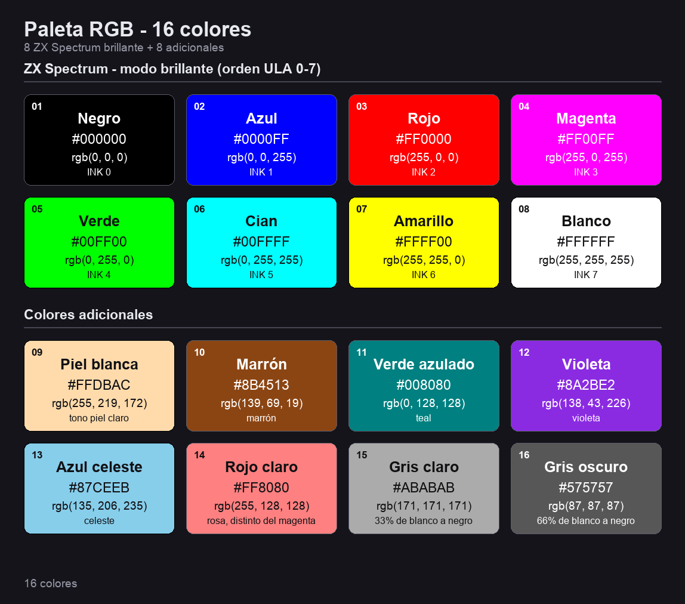

# Drean Palette

Paleta de 16 colores (*Drean palette*).

## Colores

| # | Muestra | Nombre | Hex | RGB |
|---|:---:|---|---|---|
| 0 | `⬛` | Black | `#000000` | `rgb(0, 0, 0)` |
| 1 | `🟦` | Blue | `#0000FF` | `rgb(0, 0, 255)` |
| 2 | `🟥` | Red | `#FF0000` | `rgb(255, 0, 0)` |
| 3 | `🟪` | Magenta | `#FF00FF` | `rgb(255, 0, 255)` |
| 4 | `🟩` | Green | `#00FF00` | `rgb(0, 255, 0)` |
| 5 | `🟦` | Cyan | `#00FFFF` | `rgb(0, 255, 255)` |
| 6 | `🟨` | Yellow | `#FFFF00` | `rgb(255, 255, 0)` |
| 7 | `⬜` | White | `#FFFFFF` | `rgb(255, 255, 255)` |
| 8 | `🟨` | Light Skin | `#FFDBAC` | `rgb(255, 219, 172)` |
| 9 | `🟫` | Brown | `#8B4513` | `rgb(139, 69, 19)` |
| 10 | `🟦` | Teal | `#008080` | `rgb(0, 128, 128)` |
| 11 | `🟪` | Violet | `#8A2BE2` | `rgb(138, 43, 226)` |
| 12 | `🟦` | Sky Blue | `#87CEEB` | `rgb(135, 206, 235)` |
| 13 | `🟧` | Orange | `#FF8100` | `rgb(255, 129, 0)` |
| 14 | `⬜` | Light Gray | `#ABABAB` | `rgb(171, 171, 171)` |
| 15 | `⬛` | Dark Gray | `#575757` | `rgb(87, 87, 87)` |

## Uso

La paleta se encuentra disponible en formato JSON en [`drean_palette.json`](drean_palette.json).
